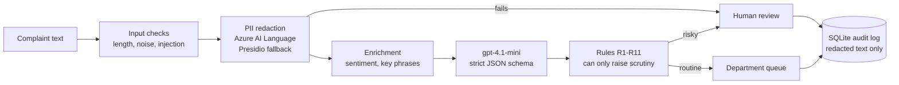

# Bank Complaint Intake Pipeline

[](https://github.com/ST-2004/Complaint-Intake-Pipeline/actions/workflows/ci.yml)

AI-assisted triage of retail-bank complaints on Azure, with privacy built in. Personal
data is redacted **before** any model sees it, the model's output is schema-validated
and checked by deterministic rules, risky cases go to a human, and an evaluation
harness measures how the whole system behaves. Terraform builds and removes the
entire environment in about two minutes each way.

> **Proof of concept on synthetic data only.** Not production banking software. Not
> affiliated with any employer or financial institution. All names, numbers and
> complaints are generated.

## Results (held-out set, never tuned on)

| | M4 baseline | **v1.0.0** | Target |
|---|---|---|---|
| Seeded PII values reaching the model or database | 1 / 23 | **0 / 23** | 0 |
| Cases needing a human that got one | 9 / 10 | **10 / 10** | >= 95% |
| Category macro-F1 | 0.92 | **0.98** | >= 0.85 |
| Severity accuracy | 0.63 | **0.80** | |
| Red-team (injection, abuse, noise, PII tricks) | 20 / 20 | **20 / 21** | >= 90% |
| HIGH + CRITICAL recall | 0.91 | **0.82** | >= 0.95 (**not met**) |
| Counterfactual consistency (name, tone, typos...) | 9 / 10 | **9 / 10** | >= 95% (**not met**) |
| Latency p95 / cost per complaint | 7.3 s / $0.0005 | 8.8 s / $0.0006 | |

The two misses are documented, not tuned away: severity is under-rated for harm
that has no dollar amount (a wrong credit report, a discrimination complaint), and
both cases still reached a human. n = 30, so one case moves a rate by 3-10 points.
Details: [hardening](docs/hardening.md), [system card](docs/system-card.md),
[report](eval/reports/2026-11-22_heldout_9ab7dba.md).

## How it works



| Principle | How it is enforced |
|---|---|
| PII never reaches the model or the logs | Redaction first, fail closed (R8); leak check on every eval run; CI fails on any leak |
| The model suggests, code and people decide | Department set in code; 11 deterministic rules; review queue with recorded overrides |
| Structured output | Strict JSON schema + Pydantic, one retry, then human review (R7) |
| Complaint text is untrusted | Delimiters, injection patterns, Azure Prompt Shields, R5; the model has no tools |
| Least privilege | Entra ID only, key auth disabled, roles scoped to two accounts |
| Measure, do not assume | Dev / held-out split, red-team, counterfactual pairs, versioned prompts and rules |
| Disposable infrastructure | Terraform apply / destroy, plus a check that nothing is left behind |

## Try it without Azure (free)

Needs Python 3.12+ (CI uses 3.14).

```powershell
python tasks.py setup              # .venv, pinned deps, pre-commit hooks
.venv\Scripts\Activate.ps1         # or: source .venv/bin/activate
python tasks.py demo               # 5 complaints -> review queue -> stats
python tasks.py test               # 680+ unit tests, no cloud
python tasks.py eval --offline     # full evaluation with Presidio + MOCK model
```

Offline mode uses Presidio for redaction and a keyword stub instead of the LLM. The
redaction, rules, routing, review queue and audit log are the real ones; the labels
are not, and reports are stamped MOCK. Demo script: [docs/demo.md](docs/demo.md).

## Run it on Azure

Needs Terraform 1.6+ and the Azure CLI. Fits in Azure for Students; a full
apply, eval and destroy cycle costs cents ([cost and limits](docs/cost-and-limits.md)).

```powershell
az login --use-device-code
az account set --subscription "<name or id>"

python tasks.py preflight          # read-only: login, region policy, F0 slot, model quota
copy infra\terraform\terraform.tfvars.example infra\terraform\terraform.tfvars   # optional
python tasks.py infra-up           # terraform init + apply (asks to confirm)
python tasks.py env                # writes .env from terraform outputs (no secrets)
python tasks.py smoke              # one PII call + one model call
python tasks.py run "My card was charged twice for the same purchase..."
python tasks.py review             # human-review queue
python tasks.py eval               # dev + red-team + counterfactual
python tasks.py infra-down         # destroy, then verify nothing is left
```

New role assignments can take 5-10 minutes to work; if `smoke` returns 401/403 right
after `infra-up`, wait and retry.

`terraform apply` creates one resource group with an Azure AI Language account (F0),
an Azure AI Services account with a `gpt-4.1-mini` deployment, and two role
assignments for the signed-in identity. Nothing is hard-coded to a subscription,
tenant or region.

Other tasks: `pii-check [--provider presidio]`, `classify-check`, `generate-data`,
`lint`, `fmt`, `leftovers`. Live tests: `pytest -m integration`.

## CI

Every push runs, with no cloud credentials: ruff, the unit tests, the offline
evaluation with a **PII gate** (the build fails if any seeded value reaches the model
input or the database), pre-commit hygiene and a secret scan, and `terraform fmt` +
`validate`. See [.github/workflows/ci.yml](.github/workflows/ci.yml).

## Limitations

- Synthetic, English-only data labelled by one person; 30 held-out cases.
- Severity under-rates harm without an amount or a date (see results).
- About 3 in 10 reviews were not strictly needed (review precision 0.71): the
  deliberate price of not missing any.
- Temperature 0 is not fully deterministic (3/30 cases differed between two runs).
- The 10K tokens/minute deployment hit rate limits during evaluation bursts; those
  cases were routed to a human, as designed.

**What a bank would still need:** real de-identified data with several annotators,
model-risk and privacy sign-off, private networking and data-residency decisions,
monitoring of drift and override rates, capacity planning, and French support. Full
list in the [system card](docs/system-card.md#9-what-a-bank-would-still-need-before-production).

## Milestones

| Milestone | Outcome |
|---|---|
| **M0** Foundations | Terraform apply, smoke and destroy verified (westus3, about 2 min each way) |
| **M1** PII | Azure and Presidio providers, 0 / 28 seeded values leaked ([details](docs/pii-redaction.md)) |
| **M2** Classifier | 10/10 schema-valid on the first attempt, versioned prompt ([details](docs/classifier.md)) |
| **M3** Rules and review | End-to-end pipeline, rules, review queue, audit log ([details](docs/rules-and-review.md)) |
| **M4** Evaluation | Dataset, harness, held-out baseline ([details](docs/evaluation.md)) |
| **M5** Hardening | Three tuning rounds on dev, one held-out run ([details](docs/hardening.md)) |
| **M6** Docs, CI, showcase | CI, offline demo, system card, v1.0.0 ([changelog](CHANGELOG.md)) |

## Repository layout

```
infra/terraform/     Terraform: versions, variables, main, outputs, example tfvars
scripts/             preflight.py, make_env.py (Python so they run on Windows too)
src/complaint_intake config, auth, input_checks, redaction/ (Azure + Presidio),
                     enrichment, schemas, prompts, model_client, mock_model, classifier,
                     rules, pipeline, store (SQLite audit + review), cli, evaluation/
prompts/             versioned prompts (classify_v1..v3)
config/              versioned rules (rules_v1..v3)
data/                synthetic only: situations, dev / held-out sets, labelling guide, samples
eval/                red-team and counterfactual sets, reports/
tests/               unit tests (offline) + integration tests (marked)
docs/                design notes per milestone, system card, demo script
.github/workflows/   CI
tasks.py             task runner (same commands on Windows, macOS and Linux)
```

## License

MIT. See [LICENSE](LICENSE).
